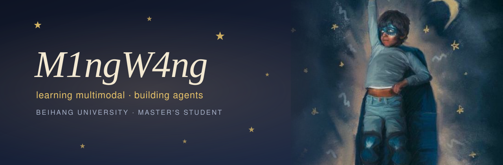
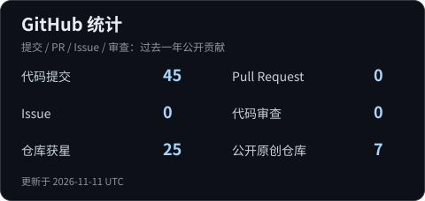
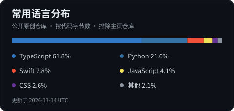

# Hi!  Nice to Meet You. :blush:

I'm **M1ngW4ng**, a first-year master's student at **Beihang University**. I'm currently learning **multimodal AI** and preparing to make it my research direction. Python is my first language, I also work with C and a bit of Swift. Outside of coursework I build **AI agents** and small tools, and I code every day with ChatGPT, Antigravity and Claude Code on macOS.

<!--
## More About Me :boy:

（待补充，参考样式是 4–5 条带表情的个人特点，例如）
:purple_heart: ...
:star: ...
:sparkles: ...
-->

## What I'm Working On :hammer_and_wrench:

:rocket: [**MiniCode**](https://github.com/MingWangD/MiniCode): a lightweight terminal coding agent in pure Python, with a ReAct loop, plan-mode guardrails and persistent memory

:page_facing_up: [**ToMarkdown**](https://github.com/MingWangD/ToMarkdown): convert documents to Markdown, with optional vision OCR and folder batch processing

:musical_note: [**Video2MP3**](https://github.com/MingWangD/Video2MP3): a native macOS app that extracts MP3 audio from video files

:brain: [**daily-algorithm-learning**](https://github.com/MingWangD/daily-algorithm-learning): daily algorithm practice

>*Exploring AI agents through learning, and understanding code through practice.*

## Find me around the WWW :earth_asia:

- Coding on: 

- Say hi at: 

## GitHub Stats

---

:paw_prints: Thanks for stopping by. Let's learn and turn ideas into code together.
