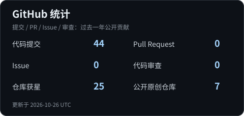
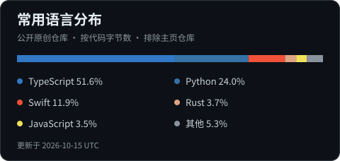

  

# MingWangD 🐾

## 👋 你好，欢迎来到我的主页

🎓 **北京航空航天大学研一**

> 在学习中探索 AI Agent，在实践中理解代码。

- 🌱 正在学习 **Python**，也使用 **C**。
- 🤖 关注 **AI Agent** 与 AI 辅助编程。
- 🛠️ 常用 **ChatGPT、Antigravity、Claude Code**。
- 🚀 正在做的项目：[**MiniCode**](https://github.com/MingWangD/MiniCode)。
- 💻 日常开发环境：**macOS**。
- 📫 邮箱：[**wmywqd@gmail.com**](mailto:wmywqd@gmail.com)。

 

## 🌱 编程语言

Python 学习中，边写边学，持续积累。

## 🤖 AI 工具箱

探索 AI Agent 的工作方式，也用 AI 工具辅助日常学习与编程。

## 🚀 我的项目

### [MiniCode](https://github.com/MingWangD/MiniCode)

基于 **Python 与 Anthropic Messages API** 构建的轻量级终端 AI 编程助手。

- **工具调用**：读取、编辑文件与执行命令。
- **计划模式**：先探索和规划，再确认执行。
- **持久记忆**：保存项目经验与上下文。
- **Skills 与子代理**：扩展任务能力，拆分探索工作。

欢迎交流、提建议，也欢迎一起探索 AI Agent。

## 📬 联系我

## 💻 开发环境

---

统计卡片每天更新。贡献统计展示过去一年公开贡献；语言分布按公开原创仓库的代码字节数计算，不代表个人熟练度。

🐾 感谢来访，一起学习，一起把想法写成代码。
